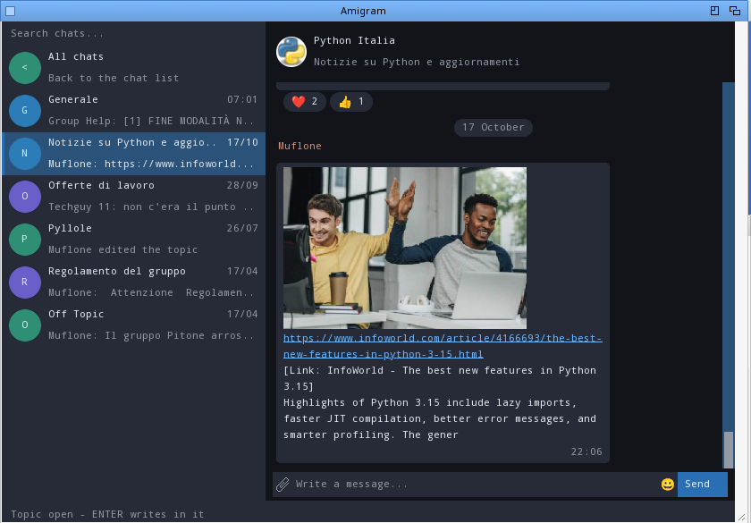

<!--
Copyright (c) 2026 Michele Dipace <michele.dipace@kaffeine.net>
SPDX-License-Identifier: GPL-3.0-or-later
-->

# Amigram - Unofficial Telegram Amiga Client

Called TelegramAmiga up to 0.0.99. A native Telegram client for AmigaOS 3,
AmigaOS 4, MorphOS and AROS, written from scratch in C on Telegram's
MTProto protocol. You log in with a normal Telegram account. It needs no
MUI, no ixemul and no AmiSSL: the cryptography is built in.

It uses the Telegram API but is not made by Telegram.

One engine, two clients: a window drawn with Intuition and GadTools, and
a text client for the Shell, which also runs on a plain 68000.



*Amigram 0.5 on MorphOS: a forum group, with its topics in place of the
chat list.*

Status: **beta 0.5** (2026-11-14). Direct chats, groups, channels and the
topics of forum groups work on all six platforms. 0.5 is the first
release with new features since the name changed: topics, search in a
chat and in all chats, the Archive, pinned messages and pinned chats,
drafts, polls, albums, stickers through a WEBP datatype, an ARexx port,
a settings panel and an update notice among them. The whole list is in
[CHANGELOG.md](CHANGELOG.md); what comes next is in
[ROADMAP.md](ROADMAP.md).

The plain-68000 package exists thanks to Paolo Arus (DaRkHoRaCe), who
tested it on an A600 round after round.

License: GNU GPL version 3 or later (MIT up to the 0.1 beta, see
[docs/LICENSE-MIT-up-to-0.1.txt](docs/LICENSE-MIT-up-to-0.1.txt)). A
non-commercial community project. Development diary:
<https://androidlab.it/en/telegram-amiga-mtproto-client-development-diary/>

<!-- patreon-support:start -->
## Support development

Amigram remains free and open source. If you find it useful, you can [support my work on Patreon](https://www.patreon.com/c/kaffeine1). Contributions help me dedicate time to development, testing and documentation. No subscription is required to use the client; public code, releases and articles remain available to everyone.

If you prefer a one-time contribution, you can [support my work on Ko-fi](https://ko-fi.com/kaffeine1).
<!-- patreon-support:end -->

## Platforms & releases

Each package holds the client, its icons, the manuals in English and
Italian and the changelog. The Telegram api credentials are inside the
client. No private files.

| Platform | CPU | Release |
|---|---|---|
| AmigaOS 3.x (68020+) | m68k | [os3-beta-0.5](https://github.com/kaffeine1/telegram-amiga/releases/tag/os3-beta-0.5) |
| AmigaOS 3.x (plain 68000, text client) | m68k | [os3-68000-beta-0.5](https://github.com/kaffeine1/telegram-amiga/releases/tag/os3-68000-beta-0.5) |
| AmigaOS 4.x | PPC | [os4-beta-0.5](https://github.com/kaffeine1/telegram-amiga/releases/tag/os4-beta-0.5) |
| MorphOS | PPC | [morphos-beta-0.5](https://github.com/kaffeine1/telegram-amiga/releases/tag/morphos-beta-0.5) |
| AROS i386 (ABIv0) | x86 | [aros-i386-beta-0.5](https://github.com/kaffeine1/telegram-amiga/releases/tag/aros-i386-beta-0.5) |
| AROS x86_64 | x86-64 | [aros-x86_64-beta-0.5](https://github.com/kaffeine1/telegram-amiga/releases/tag/aros-x86_64-beta-0.5) |
| AROS aarch64 (Raspberry Pi) | ARM64 | [aros-aarch64-beta-0.5](https://github.com/kaffeine1/telegram-amiga/releases/tag/aros-aarch64-beta-0.5) |

All releases: <https://github.com/kaffeine1/telegram-amiga/releases>.

AmigaOS 3 needs a 68020 or better and about 4 MB of free RAM, 1.5 MB of
it in one block (8 MB of fast RAM is the comfortable size); the plain-68000
package has the text client only, runs in about 2 MB of free RAM, on a
68020 with little memory too, and wants its first login made on a faster
Amiga or in an emulator. AROS i386 is the ABIv0 build and
the one for most AROS systems. AROS x86_64 needs a system built from the
current SDK (AROS One v0.38 will not run it). AROS aarch64 runs on the
native image for the Raspberry Pi 4, 400 and 5 dated 2026-08-22 or later.

## Quick start

1. Copy the drawer to a writable volume such as `Work:`. The client keeps
   its files next to itself.
2. Double-click **Amigram** (**TelegramAmiga** up to 0.0.99). On
   AmigaOS 3, **Amigram-TUI** opens the text client; elsewhere the manual
   gives its Shell command.
3. The first run asks for your phone number, the code Telegram sends and
   your 2FA password if you have one. The session is saved in
   `telegram-auth.bin` and later runs open on your chats. The client
   cannot create an account: make one first with the official app.

Coming from TelegramAmiga: copy `telegram-auth.bin` and the `data`
drawer from the old drawer into the new one, and `avatars`, `photos` and
`downloads` if you want them. Session, chats and settings come along.

On a slow 68k the 2FA check takes time: under a minute on a Vampire, about
half an hour on a stock A1200. The client works it out offline and then
reconnects, so let it run. There is no need to turn 2FA off.

## What works

- Chat list with users, groups and channels: avatars, unread counts,
  pinned chats, the Archive, drafts, mute marks, mark as unread, search,
  reorder by drag, remove, hidden chats.
- Forum groups: the topics in place of the chat list, each one read,
  written to and marked as read on its own.
- History with older messages on demand and the date where the day
  changes. Search in a chat and in all chats, the pinned messages on a
  bar under the header, a button for the mentions not yet seen.
- Long multi-line messages, replies, edit, delete, forward, @mentions,
  emoji panel, Copy/Cut/Paste. Bold, italic, strike, code and spoilers
  typed with markers. Several messages selected at once.
- Reactions, including the full list a chat allows.
- Polls and quizzes: read, vote, create, stop, see who voted.
- Photos in the chat and in a viewer, albums, link previews, a frame of
  each video, and stickers where the system has a WEBP datatype (the
  client offers to install one). A text-only mode for slow machines.
- Files both ways, several at once, up to 125 MiB on 68k and 250 MiB
  elsewhere, with Saved Messages as a cloud drawer. A downloaded file
  opens from its message.
- New-message notifications: window title, pop-up, sound (the built-in one
  or a file of your choice) and AppIcon. Mute and ring per chat, with
  the mutes kept on Telegram.
- Typing indicator, read receipts, hiding messages in groups.
- Own screen, Iconify, dark theme, remembered window, a settings panel,
  an ARexx port, and a notice when a new release is out.
- Text client: chats as tabs under F1 to F10, `/` lists the commands,
  `/find` searches the open chat.

## Not yet

Contacts, voice and video playback, files served by Telegram's CDN (some
big downloads from public channels) and creating an account.

## Privacy & security

Never share `telegram-auth.bin`, the files in `data/`, or screenshots and
logs that show them. `telegram-auth.bin` is your session: whoever has it
is in your account. If it leaks, end the session from another device.

Where the system has no secure random source, the client seeds its own
from local entropy (timer jitter, keystrokes, a saved seed file). The
weakest moment is a first login in a fresh emulator: prefer real hardware
if that matters to you.

## Build (developers)

Six lanes, one `Makefile.*` each (AmigaOS 3, AmigaOS 4, MorphOS, AROS
i386, x86_64 and aarch64); details in `docs/`. Host test:

```sh
make -f Makefile.host all
./build/host/Amigram --mtproto-self-test-fast
```

## Notes

The icon is our own design. Carlo Spadoni optimised it for each system,
put it on a standard drawer for the drawer icon, and let me ship his
versions with the program. His files are in `assets/icons/carlo-spadoni/`;
`scripts/build-icons.sh` turns them into one set per platform.

Developed with the help of LLM agents used as engineering tools.

Bug reports: platform and version, real or emulated, CPU, TCP/IP stack
and what failed. Never post auth files, phone numbers, login codes, 2FA
passwords or private messages.
